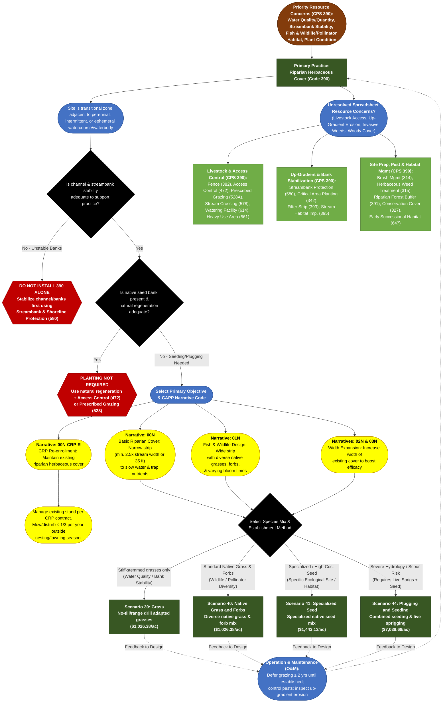

# Practice 390: Riparian Herbaceous Cover
**Source Documents:** NRCS CPS 390 (Nov 2022), FY 2026 Practice Payment Scenarios, and CAPP Narrative/Resource Concern Data

[← Back to Master Index](./README.md)

---

## 1. Decision Flowchart

---

## 2. Resource Concern & Component Mapping Matrix

| Resource Concern Category (CAPP) | Resource Concern & Components (CAPP) | Direct Match to CPS 390? | Matching Narrative Code & Scenario(s) | Required Supporting Practices (from CPS 390) |
| :--- | :--- | :--- | :--- | :--- |
| **Water (Field sediment, nutrient and pathogen loss)** | • Sediment from erosion sources • Nonpoint N & P (surface & groundwater) • Nonpoint pathogens (surface & groundwater) | **Yes (Primary Purpose)** | **00N**: Scen. 39 (Grass - stiff stems) **02N / 03N**: Scen. 39 or 40 (Width expansion) **00N-CRP-R**: CRP Maintenance | **Filter Strip (393)**, **Critical Area Planting (342)**; replace/regulate existing underground drains passing through buffer. |
| **Water (Field pesticide loss)** & **Water (Salt losses to water)** | • Nonpoint pesticide drift, leaching, & surface loss • Salt loss to surface & groundwater | **Yes (Primary Purpose)** | **00N**: Scen. 39 (Grass - stiff stems) **02N / 03N**: Scen. 39 or 40 (Width expansion) | **Filter Strip (393)**; select plant species tolerant to locally used herbicides. |
| **Soil (Concentrated erosion)** & **Soil (Wind and water erosion)** | • Bank erosion from streams/shorelines • Classic & ephemeral gully erosion • Sheet, rill, and wind erosion | **Yes (Primary Purpose)** | **00N / 02N / 03N**: Scen. 39 (deep-binding root mass) or Scen. 44 (Plugging & Seeding for high-energy sites) | **Streambank & Shoreline Protection (580)** (required if banks are unstable), **Critical Area Planting (342)**; control up-gradient concentrated flow first. |
| **Animals (Aquatic habitat)** | • Aquatic habitat for fish and other organisms • Water temperature effects on aquatic habitat | **Yes (Primary Purpose)** | **01N**: Scen. 40 (Native Grass & Forbs), Scen. 41 (Specialized Seed), Scen. 44 (Plugging & Seeding) | **Stream Habitat Improvement & Management (395)**, **Riparian Forest Buffer (391)** (for larger stream shading), **Stream Crossing (578)**. |
| **Animals (Terrestrial habitat)** | • Terrestrial habitat for wildlife and invertebrates (including pollinators) | **Yes (Primary Purpose)** | **01N**: Scen. 40 (Native Grass & Forbs), Scen. 41 (Specialized Seed), Scen. 44 (Plugging & Seeding) **00N-CRP-R**: CRP Maintenance | **Conservation Cover (327)**, **Early Successional Habitat Development (647)**; disturb &le; 1/3 of stand annually outside nesting/fawning season. |
| **Plants (Degraded plant condition)** | • Plant productivity and health • Plant structure and composition | **Yes (Primary Purpose)** | **00N / 01N / 02N / 03N**: Scen. 39, 40, 41, or 44 (based on ESD State & Transition model) **00N-CRP-R**: CRP Maintenance | **Pasture and Hayland Planting (512)**, **Range Planting (550)**, **Prescribed Grazing (528A)**. |
| **Water (Weather resilience)** & **Water (Source water depletion)** | • Ponding and flooding (floodplain storage) • Seasonal high water table, seeps, drought • Surface/groundwater depletion, drifted snow | **Partial (Secondary)** | **00N / 01N / 02N / 03N**: All Scenarios (increases floodplain water storage & infiltration) | **Stream Habitat Improvement (395)**; select species adapted to projected duration of inundation/saturation. |
| **Air (Air quality emissions)** | • GHGs - carbon stock • PM - windblown dust & field operations | **Partial (Primary / Secondary)** | **01N / 02N / 03N**: Scen. 40, 41, or 44 (maximize width/length & high-biomass species for net carbon storage) | **Conservation Cover (327)**; use species providing full ground coverage to minimize PM during establishment. |
| **Plants (Pest pressure)** | • Invasive species • Plant pest pressure & chemical resistance | **No (Supporting Only)** | *Must control invasive trees/shrubs & noxious weeds before/during establishment*. | **Brush Management (314)**, **Herbaceous Weed Treatment (315)** (conduct in a manner that mitigates pollinator impacts). |
| **Animals (Livestock production limitation)** | • Inadequate livestock water quantity/quality/distribution • Feed/forage balance & shelter | **No (Supporting Only)** | *Grazing must be deferred &ge; 2 years until established; practice provides secondary livestock forage once established*. | **Fence (382)**, **Access Control (472)**, **Watering Facility (614)**, **Stream Crossing (578)**, **Heavy Use Area Protection (561)**, **Prescribed Grazing (528A)**. |
| **Soil (Soil quality limitations)** & **Long term protection of land** | • Compaction, aggregate instability, organic matter • Loss of floodplain/wetland/forestland functions | **Indirect Co-Benefit** | **00N / 01N / 02N / 03N**: Deep root systems improve soil health and restore floodplain functions | **Riparian Forest Buffer (391)** (for forestland functions), **Prescribed Grazing (528A)** (to prevent bank compaction). |
