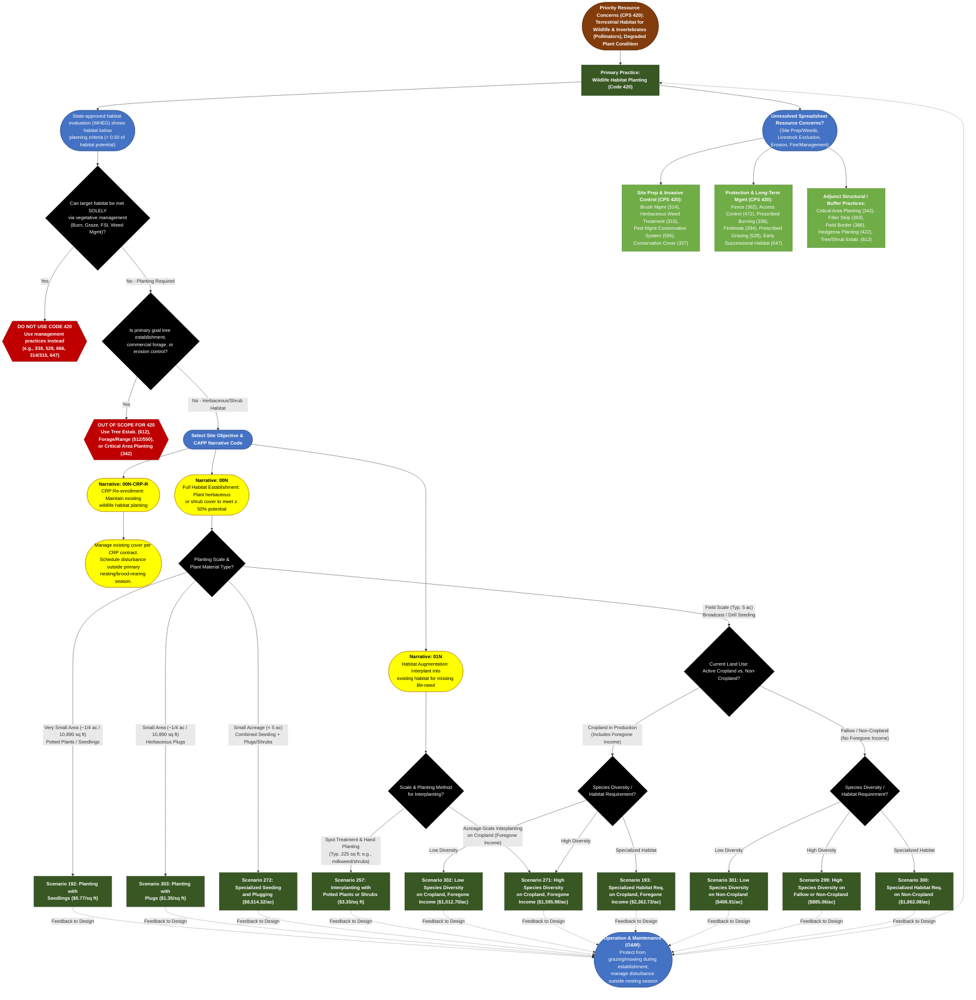

# Practice 420: Wildlife Habitat Planting
**Source Documents:** NRCS CPS 420 (Oct 2018), FY 2026 Practice Payment Scenarios, and CAPP Narrative/Resource Concern Data

[← Back to Master Index](./README.md)

---

## 1. Decision Flowchart

---

## 2. Resource Concern & Component Mapping Matrix

| Resource Concern Category (CAPP) | Resource Concern & Components (CAPP) | Direct Match to CPS 420? | Matching Narrative Code & Scenario(s) | Required Supporting Practices (from CPS 420) |
| :--- | :--- | :--- | :--- | :--- |
| **Animals (Terrestrial habitat)** | • Terrestrial habitat for wildlife and invertebrates (including pollinators & monarch butterfly) | **Yes (Primary Purpose)** | **00N**: Scen. 192, 193, 271, 272, 299, 300, 301, 302, 303 **01N**: Scen. 257 (Interplanting), Scen. 271 **00N-CRP-R**: CRP Maintenance | **Field Border (386)**, **Hedgerow Planting (422)**, **Early Successional Habitat Development (647)**, **Tree/Shrub Establishment (612)**. |
| **Plants (Degraded plant condition)** | • Plant productivity and health • Plant structure and composition | **Yes (Primary Purpose)** | **00N**: Scen. 271, 299 (High Diversity), Scen. 193, 300 (Specialized), Scen. 272 (Seed + Plugs) **01N**: Scen. 257, 271 (Augmenting diversity/structure) | **Prescribed Burning (338)**, **Prescribed Grazing (528)** (post-establishment), **Range Planting (550)**. |
| **Soil (Wind and water erosion)** & **Soil (Concentrated erosion)** | • Sheet, rill, and wind erosion • Bank, classic gully, and ephemeral gully erosion | **Partial (Co-Benefit)** | **00N**: Scen. 193, 271, 302 (Converting active annual cropland to permanent perennial cover) | **Critical Area Planting (342)** (required for severe/gully erosion), **Conservation Cover (327)**, **Filter Strip (393)**. |
| **Water (Field sediment, nutrient, pathogen, & pesticide loss)** | • Sediment from erosion sources • Nonpoint N, P, pathogen, & pesticide losses | **Partial (Co-Benefit)** | **00N**: Scen. 193, 271, 302 (Taking cropland out of production & eliminating annual tillage/agrichemical inputs) | **Filter Strip (393)**, **Field Border (386)**, **Riparian Herbaceous Cover (390)**; avoid residual herbicide carryover. |
| **Soil (Soil quality limitations)** | • Organic matter depletion & compaction • Aggregate instability & soil organism habitat loss • Subsidence & salts/chemicals | **Partial (Co-Benefit)** | **00N**: Scen. 193, 271, 302 (Permanent deep-rooted native cover restores soil organic matter & soil biota) | **Conservation Cover (327)**; select salt/pH-adapted native species. |
| **Air (Air quality emissions)** | • GHGs - carbon stock & nitrogen fertilizer • PM - windblown dust & field operations | **Partial (Co-Benefit)** | **00N**: Scen. 193, 271, 302 (Cropland conversion builds perennial carbon stock and eliminates tillage dust) | **Conservation Cover (327)**, **Field Border (386)**. |
| **Plants (Pest pressure)** | • Invasive species • Plant pest pressure & chemical resistance | **No (Supporting Only)** | *Undesirable vegetation must be controlled/suppressed prior to planting (explicitly noted in Scen. 299–301)*. | **Brush Management (314)**, **Herbaceous Weed Treatment (315)**, **Pest Management Conservation System (595)**. |
| **Plants (Fire management)** | • Wildfire hazard from biomass accumulation | **No (Supporting Only)** | *Prescribed fire is used as an O&M disturbance tool to maintain native habitat structure*. | **Prescribed Burning (338)**, **Firebreak (394)**. |
