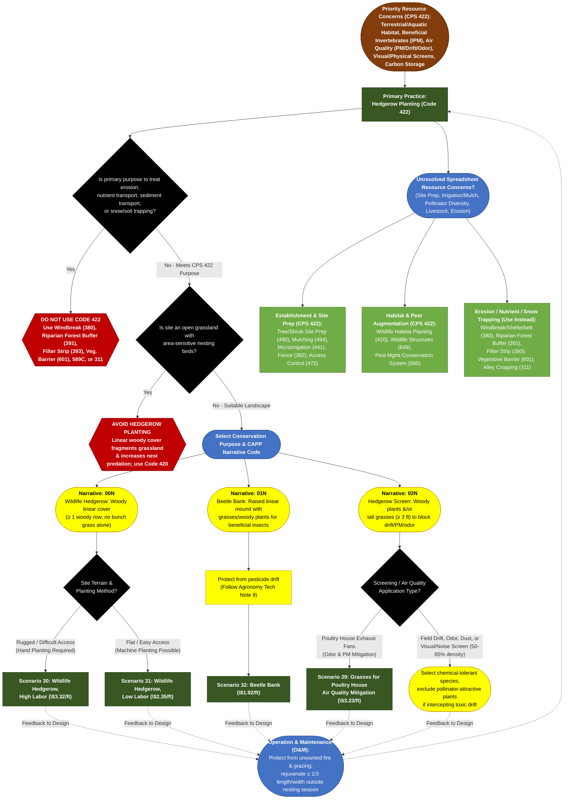

# Practice 422: Hedgerow Planting
**Source Documents:** NRCS CPS 422 (Nov 2024), FY 2026 Practice Payment Scenarios, and CAPP Narrative/Resource Concern Data

[← Back to Master Index](./README.md)

---

## 1. Decision Flowchart

---

## 2. Resource Concern & Component Mapping Matrix

| Resource Concern Category (CAPP) | Resource Concern & Components (CAPP) | Direct Match to CPS 422? | Matching Narrative Code & Scenario(s) | Required Supporting Practices (from CPS 422) |
| :--- | :--- | :--- | :--- | :--- |
| **Animals (Terrestrial habitat)** | • Terrestrial habitat for wildlife and invertebrates (pollinators, corridors, winter cover) | **Yes (Primary Purpose)** | **00N**: Scen. 30 (High Labor), Scen. 31 (Low Labor) — *must include &ge; 1 woody row* | **Wildlife Habitat Planting (420)** (to achieve full bloom diversity/winter cover), **Wildlife Structures (649)** (nest boxes). |
| **Animals (Aquatic habitat)** | • Aquatic habitat for fish and other organisms • Water temperature effects on aquatic habitat | **Yes (Primary Purpose)** | **00N**: Scen. 30 or 31 (provides food, cover, and shade/cooling to adjacent small watercourses) | **Riparian Forest Buffer (391)**, **Riparian Herbaceous Cover (390)** (if primary goal is streambank/nutrient buffering). |
| **Plants (Pest pressure)** | • Plant pest pressure • Invasive species & chemical resistance | **Yes (Primary Purpose)** | **01N**: Scen. 32 (Beetle Bank — overwintering habitat for predaceous insects/spiders) **02N**: Intercepts windblown weed seeds | **Pest Management Conservation System (595)**; follow Agronomy Tech Note 9 to protect beneficial insects from drift. |
| **Air (Air quality emissions)** | • PM - confined animal activities, windblown dust, pesticide drift, field ops • Objectionable odor - confined animal activities • GHGs - carbon stock | **Yes (Primary Purpose)** | **02N**: Scen. 29 (Grasses for Poultry House Air Quality Mitigation) or woody/grass screen (50–65% density) **00N / 01N / 02N**: Increases biomass/soil carbon | **Windbreak/Shelterbelt Establishment (380)** (for larger multi-row wind/odor/snow systems). |
| **Soil (Wind and water erosion)** & **Soil (Concentrated erosion)** | • Sheet, rill, and wind erosion • Bank, classic gully, and ephemeral gully erosion | **No (Exclusion Rule)** | *CPS 422 explicitly excludes linear plantings installed primarily to treat erosion or trap soil*. | **Windbreak/Shelterbelt (380)**, **Vegetative Barrier (601)**, **Cross Wind Trap Strips (589C)**, **Alley Cropping (311)**. |
| **Water (Field sediment, nutrient, pathogen, & pesticide loss)** | • Sediment from erosion sources • Nonpoint N, P, & pathogen losses • Nonpoint pesticide drift to surface water | **Partial (Drift Only)** | **02N**: Intercepts airborne **pesticide drift** (exclude pollinator plants if drift is toxic). *Do not use 422 for surface runoff sediment/nutrients*. | **Filter Strip (393)**, **Riparian Forest Buffer (391)** (required to reduce surface sediment and nutrient transport). |
| **Soil (Soil quality limitations)** | • Organic matter depletion • Compaction, aggregate instability, salts/chemicals, soil organism habitat | **Indirect Co-Benefit** | **00N / 01N / 02N**: Increases soil organic carbon and soil biota beneath perennial hedgerow | **Tree/Shrub Site Preparation (490)**, **Mulching (484)**, **Irrigation System, Microirrigation (441)**. |
| **Animals (Livestock production limitation)** | • Inadequate livestock shelter • Feed/forage balance & livestock water | **Partial (Living Fence)** | **00N / 02N**: Living fences can restrict animal movement (use non-palatable, non-toxic, thorny species). | **Fence (382)**, **Access Control (472)** (required to protect hedgerow from grazing/browsing/trampling). |
| **Water (Weather resilience)** | • Drifted snow • Ponding, flooding, drought susceptibility | **No (Exclusion Rule)** | *CPS 422 warns against undesirable snow trapping; use 380 when snow trapping is a primary purpose*. | **Windbreak/Shelterbelt Establishment (380)** (for snow management), **Microirrigation (441)** (for drought establishment). |
| **Plants (Fire management)** | • Wildfire hazard from biomass accumulation | **No (O&M Protection)** | *Hedgerows must be protected from unwanted fire throughout their lifespan (CPS 422 O&M)*. | **Firebreak (394)**, **Fuel Break (383)**. |
| **Long term protection of land, Water (Depletion/Pollutants), Air (Ozone/Reactive N), Energy** | • Threat of conversion, loss of floodplain/wetland/forest functions • Groundwater/irrigation depletion, confined storage • Ozone, Reactive N, Energy efficiency | **No Association** | *No 422 Payment Scenario resolves these components* (present in CSV only due to system-wide RC table cross-join). | Not addressed by CPS 422. Planner must use dedicated wetland, irrigation, waste storage, air, or energy standards. |
