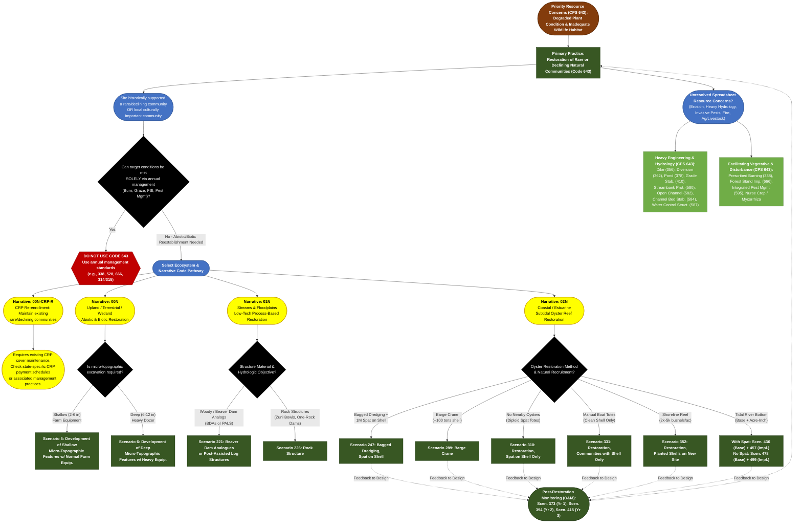

# Practice 643: Restoration of Rare or Declining Natural Communities
**Source Documents:** NRCS CPS 643, FY 2026 Practice Payment Scenarios, and CAPP Narrative/Resource Concern Data

[← Back to Master Index](./README.md)

---

## 1. Decision Flowchart

---

## 2. Resource Concern & Component Mapping Matrix

| Resource Concern Category (CAPP) | Resource Concern & Components (CAPP) | Direct Match to CPS 643? | Matching Narrative Code & Scenario(s) | Required Supporting Practices (from CPS 643) |
| :--- | :--- | :--- | :--- | :--- |
| **Plants (Degraded plant condition)** | • Plant productivity and health • Plant structure and composition | **Yes (Primary Purpose)** | **00N**: Scen. 5 (Shallow Micro-Topo), Scen. 6 (Deep Micro-Topo) **01N**: Scen. 221 (BDAs/PALS), Scen. 226 (Rock) **00N-CRP-R**: CRP Maintenance | Facilitating practices per CPS 643: Prescribed Burning, Forest Stand Improvement, local genotype seeding, nurse crops. |
| **Animals (Terrestrial habitat)** | • Terrestrial habitat for wildlife and invertebrates | **Yes (Primary Purpose)** | **00N**: Scen. 5 (6'x6' depressions/mounds), Scen. 6 (10'x10' depressions/mounds) **01N**: Scen. 221, Scen. 226 | Stage restoration or conserve adjacent refugia habitat for disturbance-intolerant wildlife. |
| **Animals (Aquatic habitat)** | • Aquatic habitat for fish and other organisms • Water temperature effects on aquatic habitat | **Yes (Primary Purpose)** | **01N (Streams)**: Scen. 221 (BDAs/PALS) **02N (Estuaries)**: Scen. 247, 289, 310, 331, 352, 436/457, 478/499 **Monitoring**: Scen. 373, 394, 415 | **Open Channel (582)**, **Channel Bed Stabilization (584)**, **Structure for Water Control (587)**. |
| **Soil (Concentrated erosion)** & **Soil (Wind and water erosion)** | • Bank erosion from streams/shorelines • Classic & ephemeral gully erosion • Sheet, rill, and wind erosion | **Partial (Secondary)** | **01N (Gullies/Channels)**: Scen. 226 (Rock Structure / Zuni bowls for head-cutting), Scen. 221 (BDAs) **00N (Sheet/Rill)**: Scen. 5 & 6 (reduces runoff) | **Grade Stabilization Structure (410)**, **Streambank & Shoreline Protection (580)**, **Diversion (362)**. |
| **Water (Weather resilience)** & **Water (Source water depletion)** | • Ponding and flooding • Seasonal high water table & seeps • Drought susceptibility & moisture mgmt • Surface/groundwater depletion, drifted snow | **Partial (Abiotic Hydrology)** | **00N**: Scen. 5 & 6 (increases water infiltration, creates short-duration ponding <7 days) **01N**: Scen. 221 (raises water tables, reconnects floodplains) | **Dike (356)**, **Diversion (362)**, **Pond (378)**, **Structure for Water Control (587)**. |
| **Soil (Soil quality limitations)** | • Aggregate instability & compaction • Organic matter depletion & subsidence • Concentration of salts/chemicals • Soil organism habitat loss | **Partial (Abiotic Soil)** | **00N**: Scen. 5 & 6 (plowing/loosening compacted soil; depressions trap organic matter/nutrients) | Restore soil texture/chemistry (pH, salinity, fertility); inoculate **soil mycorrhiza**; use **nurse crops**. |
| **Plants (Pest pressure)** | • Invasive species • Plant pest pressure • Chemical resistance | **No (Supporting Only)** | *Cannot use 643 if pest management alone solves the issue*. | **Integrated Pest Management (IPM)** (CPS 643 Considerations); weed/invasive removal prior to planting. |
| **Plants (Fire management)** | • Wildfire hazard from biomass accumulation | **No (Supporting Only)** | *Cannot use 643 if prescribed burning alone solves the issue*. | **Prescribed Burning** (CPS 643 Facilitating Practices). |
| **Water (Field sediment, nutrient, pathogen, pesticide, & salt loss)** | • Sediment from erosion sources • Nonpoint N, P, pathogen, pesticide, & salt losses | **Indirect Co-Benefit** | **00N**: Scen. 5 & 6 (depressions capture sediment/nutrients) **02N**: All Oyster Scenarios (bivalve filtration removes nutrients/sediment) | **Diversion (362)**, **Nurse Crops** (to reduce residual pesticides and excess fertility). |
| **Long term protection of land** | • Threat of conversion (ag/grassland) • Loss of floodplain, forestland, or wetland functions | **Indirect / Administrative** | **00N-CRP-R** (maintains enrolled CRP land) **01N** (restores floodplain functions) **00N** (Scen. 6 pre-wetland restoration) | Requires easement/program enrollment outside CPS 643; pair with wetland/forestland standards. |
