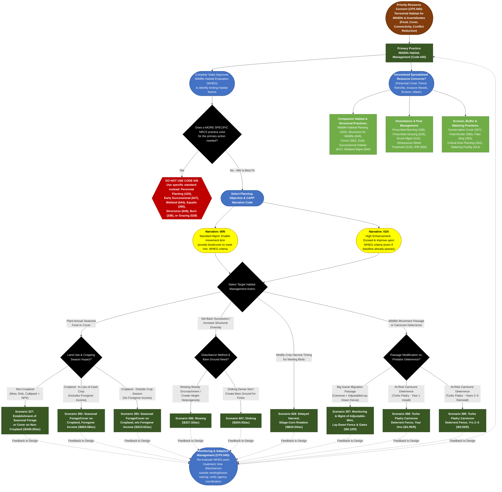

# Practice 645: Wildlife Habitat Management
**Source Documents:** NRCS CPS 645 (Jan 2026), FY 2026 Practice Payment Scenarios, and CAPP Narrative/Resource Concern Data *(listed in CAPP as Upland Wildlife Habitat Management)*

[← Back to Master Index](./README.md)

---

## 1. Decision Flowchart

---

## 2. Resource Concern & Component Mapping Matrix

| Resource Concern Category (CAPP) | Resource Concern & Components (CAPP) | Direct Match to CPS 645? | Matching Narrative Code & Scenario(s) | Required Supporting Practices (from CPS 645) |
| :--- | :--- | :--- | :--- | :--- |
| **Animals (Terrestrial habitat)** | • Terrestrial habitat for wildlife and invertebrates (food, seasonal cover, nesting/brood-rearing, migration connectivity, reducing carnivore habitat sinks) | **Yes (Primary Purpose)** | **00N** (Meet min. WHEG) & **01N** (Exceed WHEG): • **Annual Food/Cover**: Scen. 327, 392, 393 • **Succession/Structure**: Scen. 586 (Mowing), 607 (Disking) • **Nesting Timing**: Scen. 628 (Delayed Harvest) • **Connectivity/Deterrence**: Scen. 397, 398, 399 | **Wildlife Habitat Planting (420)** (for perennial cover), **Structures for Wildlife (649)** (fence retrofits/nest boxes), **Fence (382)**, **Early Successional Habitat (647)**. |
| **Plants (Degraded plant condition)** | • Plant productivity and health • Plant structure and composition | **Partial (Structural Goal)** | **00N / 01N**: Scen. 586 (Mowing) & Scen. 607 (Disking) set back succession and increase structural/forb heterogeneity | **Prescribed Burning (338)**, **Prescribed Grazing (528)**, **Range Planting (550)**, **Forest Stand Improvement (666)**. |
| **Soil (Wind and water erosion)** & **Soil (Concentrated erosion)** | • Sheet, rill, and wind erosion • Bank, classic gully, and ephemeral gully erosion | **Partial (Off-Season Cover / Caution)** | **00N / 01N**: Scen. 393 (off-season annual cover reduces winter erosion); *use caution with Scen. 607 (Disking) on erodible slopes* | **Conservation Cover (327)**, **Critical Area Planting (342)**, **Cover Crop (340)**; follow soil loss tolerance (T) limits when disking. |
| **Plants (Pest pressure)** | • Invasive species • Plant pest pressure & chemical resistance | **No (Supporting / IPM)** | *CPS 645 avoids non-native/invasive species; beneficial insect habitat supports IPM*. | **Pest Management Conservation System (595)**, **Brush Management (314)**, **Herbaceous Weed Treatment (315)**, **Hedgerow Planting (422)** (Beetle Bank). |
| **Animals (Livestock production limitation)** | • Inadequate livestock shelter & water • Feed and forage balance | **Partial (Conflict / Fence Interface)** | **00N / 01N**: Scen. 397 (adjustable/lay-down livestock fences), Scen. 398 & 399 (Turbo Fladry protects vulnerable livestock from wolves) | **Fence (382)** (wildlife-friendly design), **Prescribed Grazing (528)**, **Watering Facility (614)** (with wildlife escape ramps). |
| **Water (Field sediment, nutrient, pathogen, & pesticide loss)** | • Sediment from erosion sources • Nonpoint N, P, pathogen, & pesticide losses | **Indirect Co-Benefit** | **00N / 01N**: Scen. 392 & 393 (annual cover scavenges residual N and reduces runoff); *protect habitat from pesticide drift* | **Filter Strip (393)**, **Field Border (386)**, **Riparian Herbaceous Cover (390)**, **Pest Management (595)**. |
| **Animals (Aquatic habitat)** | • Aquatic habitat for fish and other organisms • Water temperature effects on aquatic habitat | **No (Use Specific Standard)** | *CPS 645 directs planners to use specific aquatic/wetland standards when primary habitat is aquatic*. | **Stream Habitat Improvement & Management (395)**, **Wetland Wildlife Habitat Management (644)**, **Riparian Forest Buffer (391)**. |
| **Plants (Fire management)** & **Soil (Soil quality limitations)** | • Wildfire hazard from biomass accumulation • Organic matter depletion, compaction, salts | **No (Supporting / Indirect)** | *Mowing (Scen. 586) reduces woody fuel accumulation; annual cover adds organic matter*. | **Prescribed Burning (338)**, **Firebreak (394)**, **Soil Carbon Amendment (336)**. |
