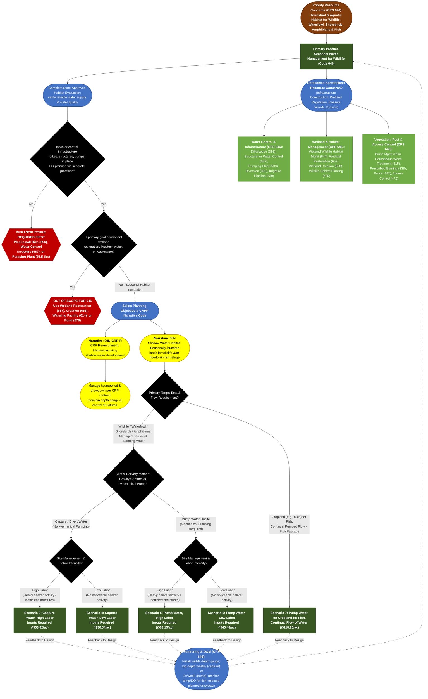

# Practice 646: Seasonal Water Management for Wildlife
**Source Documents:** NRCS CPS 646 (Nov 2024), FY 2026 Practice Payment Scenarios, and CAPP Narrative/Resource Concern Data

[← Back to Master Index](./README.md)

---

## 1. Decision Flowchart

---

## 2. Resource Concern & Component Mapping Matrix

| Resource Concern Category (CAPP) | Resource Concern & Components (CAPP) | Direct Match to CPS 646? | Matching Narrative Code & Scenario(s) | Required Supporting Practices (from CPS 646) |
| :--- | :--- | :--- | :--- | :--- |
| **Animals (Terrestrial habitat)** | • Terrestrial habitat for wildlife and invertebrates (waterfowl, shorebirds, wading birds, amphibians, reptiles, mammals) | **Yes (Primary Purpose)** | **00N**: • **Gravity Capture**: Scen. 3 (High Labor), Scen. 4 (Low Labor) • **Mechanical Pump**: Scen. 5 (High Labor), Scen. 6 (Low Labor) **00N-CRP-R**: CRP Maintenance | **Wetland Wildlife Habitat Management (644)**, **Wildlife Habitat Planting (420)**, **Dike/Levee (356)**, **Structure for Water Control (587)**; exclude predatory fish if managing for amphibians. |
| **Animals (Aquatic habitat)** | • Aquatic habitat for fish and other organisms (floodplain/off-channel refuge & rearing) • Water temperature effects on aquatic habitat | **Yes (Primary Purpose)** | **00N**: • **Cropland Fish Habitat**: Scen. 7 (Pump Water on Cropland for Fish, Continual Flow — monitors temp &amp; dissolved oxygen) • **Floodplain Refuge**: Scen. 3 or 4 | **Stream Habitat Improvement &amp; Management (395)**, **Aquatic Organism Passage (396)**, **Structure for Water Control (587)** (modified for fish passage). |
| **Water (Weather resilience)** | • Ponding and flooding • Seasonal high water table &amp; seeps • Naturally available moisture use | **Partial (Hydroperiod Mgmt)** | **00N**: Scen. 3–7 (Active regulation of seasonal inundation depth, timing, and drawdown schedules) | **Structure for Water Control (587)**, **Dike/Levee (356)**, **Diversion (362)**, **Subsurface Drain (606)** (where drainage regulation is needed). |
| **Long term protection of land** | • Loss of wetland functions and values • Loss of floodplain functions and values • Threat of conversion | **Partial (Functional / CRP)** | **00N-CRP-R** (maintains existing shallow water development on CRP) **00N** (restores seasonal floodplain/wetland hydroperiods) | **Wetland Restoration (657)**, **Wetland Creation (658)**, **Wetland Enhancement (659)** (required for permanent wetland restoration/development). |
| **Plants (Degraded plant condition)** & **Plants (Pest pressure)** | • Plant productivity &amp; health, structure &amp; composition • Invasive species &amp; plant pest pressure | **No (Supporting / Drawdown)** | *Timed drawdowns stimulate moist-soil annuals; invasive wetland plants must be controlled via supporting practices*. | **Wetland Wildlife Habitat Management (644)**, **Herbaceous Weed Treatment (315)**, **Brush Management (314)**, **Prescribed Burning (338)**. |
| **Water (Field sediment, nutrient, pathogen, &amp; pesticide loss)** | • Sediment from erosion sources • Nonpoint N, P, pathogen, &amp; pesticide losses | **Indirect Co-Benefit / Caution** | **00N**: Impounded seasonal water settles suspended sediments and retains nutrients prior to scheduled drawdown; *verify water supply is free of harmful pesticides/contaminants*. | **Filter Strip (393)**, **Sediment Basin (350)**, **Pest Management Conservation System (595)**. |
| **Soil (Wind and water erosion)** & **Soil (Concentrated erosion)** | • Sheet, rill, wind, bank, and gully erosion | **No (Infrastructure / Caution)** | *Avoid erosive discharge during drawdown; physical bank/gully stabilization requires structural practices*. | **Grade Stabilization Structure (410)**, **Streambank &amp; Shoreline Protection (580)**, **Critical Area Planting (342)**. |
| **Animals (Livestock production limitation)** | • Inadequate livestock water quantity/quality/distribution • Feed/forage balance &amp; shelter | **No (Exclusion Rule)** | *CPS 646 is not for livestock watering; livestock must be excluded or managed so they do not degrade water quality/habitat*. | **Fence (382)**, **Access Control (472)**, **Watering Facility (614)**, **Prescribed Grazing (528)**. |
