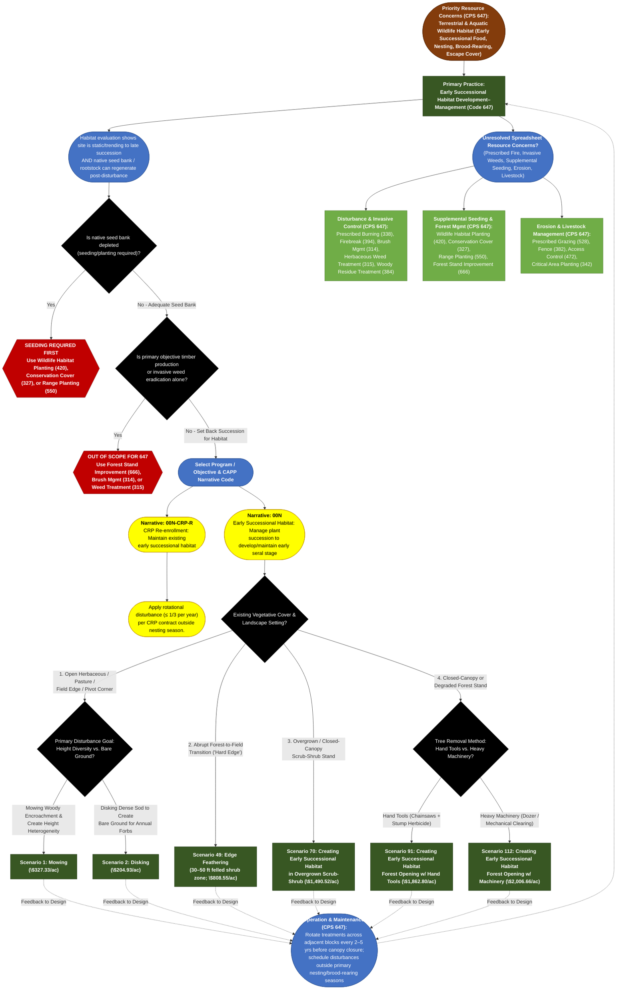

# Practice 647: Early Successional Habitat Development–Management
**Source Documents:** NRCS CPS 647 (Nov 2022), FY 2026 Practice Payment Scenarios, and CAPP Narrative/Resource Concern Data

[← Back to Master Index](./README.md)

---

## 1. Decision Flowchart

---

## 2. Resource Concern & Component Mapping Matrix

| Resource Concern Category (CAPP) | Resource Concern & Components (CAPP) | Direct Match to CPS 647? | Matching Narrative Code & Scenario(s) | Required Supporting Practices (from CPS 647) |
| :--- | :--- | :--- | :--- | :--- |
| **Animals (Terrestrial habitat)** | • Terrestrial habitat for wildlife and invertebrates (brood-rearing bare ground, annual forbs, soft-mast shrubs, feathered forest edges, forest openings) | **Yes (Primary Purpose)** | **00N**: • **Herbaceous/Pasture**: Scen. 1 (Mowing), Scen. 2 (Disking) • **Forest Edge**: Scen. 49 (Edge Feathering) • **Scrub-Shrub**: Scen. 70 • **Forest Opening**: Scen. 91 (Hand), Scen. 112 (Machine) **00N-CRP-R**: CRP Maintenance | **Prescribed Burning (338)**, **Wildlife Habitat Planting (420)** (if seed bank is lacking), **Structures for Wildlife (649)** (brush piles/snags from felled trees). |
| **Animals (Aquatic habitat)** | • Aquatic habitat for fish and other organisms • Water temperature effects on aquatic habitat | **Partial (Riparian Transition)** | **00N**: Scen. 1 (Mowing) or Scen. 49 (Edge Feathering) along transitional upland/riparian edges (*maintain shading buffer directly over stream*) | **Riparian Herbaceous Cover (390)**, **Riparian Forest Buffer (391)** (do not remove canopy shading where water temperature is a concern). |
| **Plants (Degraded plant condition)** | • Plant productivity and health • Plant structure and composition | **Yes (Primary Purpose)** | **00N**: Scen. 1, 2, 49, 70, 91, 112 (Breaks up monotypic sod/closed canopy to restore structural &amp; forb diversity) | **Prescribed Grazing (528)**, **Forest Stand Improvement (666)**, **Range Planting (550)**. |
| **Plants (Pest pressure)** | • Invasive species • Plant pest pressure &amp; chemical resistance | **No (Supporting / Caution)** | *Soil disturbance (Scen. 2 Disking) and canopy opening (Scen. 70, 91, 112) can stimulate dormant invasive weeds if not pre-treated*. | **Brush Management (314)**, **Herbaceous Weed Treatment (315)**, **Pest Management Conservation System (595)**. |
| **Plants (Fire management)** | • Wildfire hazard from biomass accumulation | **Partial (Fuel Reduction / Residue)** | **00N**: Scen. 1 (Mowing) &amp; Scen. 70 (Mulching) reduce dense standing thatch/shrub fuel loads; *manage felled slash in Scen. 49, 91, 112* | **Prescribed Burning (338)**, **Firebreak (394)**, **Woody Residue Treatment (384)**. |
| **Soil (Wind and water erosion)** & **Soil (Concentrated erosion)** | • Sheet, rill, wind, bank, and gully erosion | **No (Caution / Supporting)** | *Avoid Scen. 2 (Disking) and Scen. 112 (Dozer) on steep/erodible slopes or concentrated flow areas; follow soil loss tolerance (T)*. | **Critical Area Planting (342)**, **Conservation Cover (327)**, **Filter Strip (393)**. |
| **Animals (Livestock production limitation)** | • Feed and forage balance • Inadequate livestock shelter &amp; water | **No (Supporting / Grazing Interface)** | *CPS 647 is not for livestock forage production; grazing may be used post-disturbance as a management tool*. | **Prescribed Grazing (528)**, **Fence (382)**, **Access Control (472)**. |
| **Soil (Soil quality), Water (Quality/Quantity/Resilience), Long term protection, Air, Energy** | • Compaction, organic matter, salts, subsidence • Sediment, nutrients, pathogens, pesticides, depletion • Threat of conversion, GHGs, Odor, Ozone, PM, Energy | **No Association** | *No 647 Payment Scenario resolves these components* (present in CSV only due to system-wide RC table cross-join). | Not addressed by CPS 647. Planner must use dedicated soil health, water quality, irrigation, air, or energy standards. |
