# Practice 649: Structures for Wildlife
**Source Documents:** NRCS CPS 649 (Oct 2022), FY 2026 Practice Payment Scenarios, and CAPP Narrative/Resource Concern Data

[← Back to Master Index](./README.md)

---

## 1. Decision Flowchart

```mermaid
flowchart TD
    %% Styling matching KS Range/Pasture Examples
    classDef header fill:#833C0C,stroke:#592808,color:#FFFFFF,font-weight:bold
    classDef primary fill:#385723,stroke:#203814,color:#FFFFFF,font-weight:bold
    classDef supporting fill:#70AD47,stroke:#507E32,color:#FFFFFF
    classDef reasoning fill:#FFFF00,stroke:#BF9000,color:#000000
    classDef resource fill:#4472C4,stroke:#2F5597,color:#FFFFFF
    classDef decision fill:#000000,stroke:#000000,color:#FFFFFF
    classDef stop fill:#C00000,stroke:#800000,color:#FFFFFF,font-weight:bold

    Start(["<b>Priority Resource Concerns (CPS 649):</b><br/>Terrestrial &amp; Aquatic Wildlife Habitat (Missing Structural Elements or Injury/Mortality Risks)"]):::header
    P649["<b>Primary Practice:</b><br/>Structures for Wildlife (Code 649)"]:::primary

    Start --> P649

    %% Eligibility & Scope Gates (CPS 649)
    Elig1(["Wildlife habitat evaluation confirms missing/deficient<br/>structural habitat component OR wildlife mortality hazard"]):::resource
    Gate_Scope{"Is primary need building a new livestock fence,<br/>new water trough, or complex instream engineering?"}:::decision
    Stop_Scope{{"<b>OUT OF SCOPE FOR 649</b><br/>Use Fence (382), Watering Facility (614),<br/>Stream Habitat Imp. (395), or AOP (396)"}}:::stop

    P649 --> Elig1 --> Gate_Scope
    Gate_Scope -->|Yes| Stop_Scope
    Gate_Scope -->|No - Valid Structure or Retrofit| N_00

    %% Single CAPP Narrative Code
    N_00(["<b>CAPP Narrative: 00N</b><br/>Install structure for loafing, escape, nesting, rearing, roosting,<br/>perching, basking OR modify existing structure to reduce mortality"]):::reasoning

    N_00 --> Gate_Cat{"Select Target Structural Category"}:::decision

    %% Branch 1: Nesting, Rearing, Roosting & Perching
    Gate_Cat -->|"1. Nesting, Rearing,<br/>Roosting &amp; Perching"| Gate_Nest{"Target Taxa &amp;<br/>Mounting Method?"}:::decision
    Gate_Nest -->|"Small Box (Birds/Bees/Bats)<br/>Direct Tree/Building Mount"| Scen79["<b>Scenario 79:</b> Nesting Box, Small,<br/>without Pole (\$55.46/ea)"]:::primary
    Gate_Nest -->|"Small Box (Bluebirds/Waterfowl)<br/>Wood Pole (No Guard)"| Scen2["<b>Scenario 2:</b> Nesting Box, Small,<br/>with Wood Pole (\$86.55/ea)"]:::primary
    Gate_Nest -->|"Large Box (Waterfowl/Bats/Owls)<br/>Direct Tree/Building Mount"| Scen55["<b>Scenario 55:</b> Nesting Box, Large<br/>(\$144.06/ea)"]:::primary
    Gate_Nest -->|"Steel Pole + Predator Guard OR<br/>Buried Burrowing Owl Structure"| Scen4["<b>Scenario 4:</b> Nesting Box or Raptor Perch<br/>w/ Pole, or Underground Struct. (\$333.03/ea)"]:::primary
    Gate_Nest -->|"Utility Pole Nest Platform<br/>or Raptor Perch"| Scen56["<b>Scenario 56:</b> Artificial Raptor Perch<br/>or Platform (\$1,183.02/ea)"]:::primary
    Gate_Nest -->|"Large Tree Crown Cut/Reshaped<br/>for Raptor/Owl/Waterfowl Nest"| Scen63["<b>Scenario 63:</b> Tree Structure for<br/>Raptors or Owls (\$1,437.12/ea)"]:::primary
    Gate_Nest -->|"Single Tree Girdle / Hinge Cut<br/>(Standing Snag for Cavities/Bats)"| Scen62["<b>Scenario 62:</b> Snag Creation and<br/>Single Hinge Cut (\$16.64/ea)"]:::primary

    %% Branch 2: Escape, Loafing, Basking & Overwintering Cover
    Gate_Cat -->|"2. Escape, Loafing,<br/>Basking &amp; Spawning Cover"| Gate_Cov{"Habitat Setting &amp;<br/>Structure Material?"}:::decision
    Gate_Cov -->|"Small Brush Pile / Hinge Cut<br/>(2-3 trees &lt;12 in; ~10x20 ft)"| Scen7["<b>Scenario 7:</b> Brush Pile and<br/>Hinge Cut, Small (\$45.41/ea)"]:::primary
    Gate_Cov -->|"Large Brush Pile / Hinge Cut<br/>(5-10 trees &ge;12 in; ~30x50 ft)"| Scen77["<b>Scenario 77:</b> Brush Pile and<br/>Hinge Cut, Large (\$196.02/ea)"]:::primary
    Gate_Cov -->|"Upland/Wetland Large Woody Log<br/>(Basking, Shelter, Invertebrates)"| Scen57["<b>Scenario 57:</b> Downed Habitat Log<br/>(\$167.77/ea)"]:::primary
    Gate_Cov -->|"Excavated or Above-Ground Rock<br/>(Herptile/Wildlife Hibernacula)"| Scen61["<b>Scenario 61:</b> Hibernacula or<br/>Rock Structure (\$1,839.95/ea)"]:::primary
    Gate_Cov -->|"Deepwater Floating Platform<br/>(Reptile/Bird Basking &amp; Resting)"| Scen60["<b>Scenario 60:</b> Floating Basking<br/>Structures (\$267.57/ea)"]:::primary
    Gate_Cov -->|"Deepwater / Undercut Bank<br/>(Fish Cover &amp; Spawning)"| Scen59["<b>Scenario 59:</b> Fish Habitat<br/>Structure (\$920.11/ea)"]:::primary

    %% Branch 3: Retrofits for Mortality Reduction & Passage
    Gate_Cat -->|"3. Retrofits for Mortality<br/>Reduction &amp; Passage"| Gate_Ret{"Existing Facility Type?"}:::decision
    Gate_Ret -->|"Watering Trough / Tank<br/>(Prevent Small Wildlife Drowning)"| Scen5["<b>Scenario 5:</b> Escape Ramp<br/>(\$94.16/ea)"]:::primary
    Gate_Ret -->|"High-Risk Wire Fence<br/>(Collision Visibility Only)"| Scen6["<b>Scenario 6:</b> Fence Markers,<br/>Vinyl Undersill (\$0.24/ft)"]:::primary
    Gate_Ret -->|"Non-Wildlife-Friendly Fence<br/>(Replace 3-4 Wires + Markers)"| Scen58["<b>Scenario 58:</b> Fence Retrofit for<br/>Wildlife (\$1.92/ft)"]:::primary
    Gate_Ret -->|"Existing Fence Blocking Big Game<br/>(Install Strategic Passage Gates)"| Scen78["<b>Scenario 78:</b> Gate for Safe Movement<br/>of Ungulates (\$1,535.75/ea)"]:::primary

    %% Branch 4: Carnivore Conflict Deterrence
    Gate_Cat -->|"4. At-Risk Carnivore<br/>Conflict Deterrence"| Scen76["<b>Scenario 76:</b> 12 Foot Electric Mat,<br/>Large, Carnivore Deterrent (\$4,659.24/ea)"]:::primary

    %% Operation & Maintenance Feedback Loop
    OM(["<b>Operation &amp; Maintenance (CPS 649):</b><br/>Clean nest boxes annually outside nesting season; inspect predator guards,<br/>escape ramps, markers &amp; electric mats; protect brush piles from unwanted fire"]):::resource
    Scen79 & Scen2 & Scen55 & Scen4 & Scen56 & Scen63 & Scen62 & Scen7 & Scen77 & Scen57 & Scen61 & Scen60 & Scen59 & Scen5 & Scen6 & Scen58 & Scen78 & Scen76 -.->|Feedback to Design| OM
    OM -.-> P649

    %% Supporting Practices Fallback for Non-649 Resource Concerns
    Fallback(["<b>Unresolved Spreadsheet Resource Concerns?</b><br/>(Vegetative Cover, New Fences/Water, Stream Engineering, Fire/Weeds)"]):::resource
    P649 --> Fallback

    Fallback --> Supp_Hab["<b>Vegetative &amp; Management Habitat Practices:</b><br/>Wildlife Habitat Planting (420), Wildlife Habitat Mgmt (645),<br/>Hedgerow Planting (422), Forest Stand Improvement (666)"]:::supporting
    Fallback --> Supp_Infra["<b>New Structural &amp; Aquatic Engineering Practices:</b><br/>Fence (382), Watering Facility (614),<br/>Stream Habitat Improvement (395), Aquatic Organism Passage (396)"]:::supporting
    Fallback --> Supp_Prot["<b>Protection &amp; Disturbance Control:</b><br/>Access Control (472), Firebreak (394),<br/>Brush Management (314), Herbaceous Weed Treatment (315)"]:::supporting
```

---

## 2. Resource Concern & Component Mapping Matrix

| Resource Concern Category (CAPP) | Resource Concern & Components (CAPP) | Direct Match to CPS 649? | Matching Narrative Code & Scenario(s) | Required Supporting Practices (from CPS 649) |
| :--- | :--- | :--- | :--- | :--- |
| **Animals (Terrestrial habitat)** | • Terrestrial habitat for wildlife and invertebrates (nesting, roosting, perching, escape/loafing/basking cover, hibernation, safe movement, reducing carnivore sinks) | **Yes (Primary Purpose)** | **00N**: • **Nesting/Perching**: Scen. 2, 4, 55, 56, 62, 63, 79 • **Cover/Basking/Hibernacula**: Scen. 7, 57, 60, 61, 77 • **Retrofits/Passage**: Scen. 5, 6, 58, 78 • **Carnivore Deterrence**: Scen. 76 | **Wildlife Habitat Planting (420)**, **Wildlife Habitat Management (645)** (e.g., Scen. 397 for active gate/lay-down fence management), **Hedgerow Planting (422)**. |
| **Animals (Aquatic habitat)** | • Aquatic habitat for fish and other organisms (cover, spawning, basking/resting) • Water temperature effects on aquatic habitat | **Yes (Primary Purpose)** | **00N**: • **Fish Cover/Spawning**: Scen. 59 (Fish Habitat Structure) • **Reptile/Bird Basking**: Scen. 60 (Floating Basking Structures) • **Wetland Logs**: Scen. 57 (Downed Habitat Log) | **Stream Habitat Improvement &amp; Management (395)**, **Aquatic Organism Passage (396)** (required for complex hydraulic structures or channel modifications). |
| **Animals (Livestock production limitation)** | • Inadequate livestock water quantity, quality and distribution • Inadequate livestock shelter &amp; feed/forage balance | **Partial (Water Quality &amp; Fence Interface)** | **00N**: • **Water Trough Quality**: Scen. 5 (Escape Ramp prevents wildlife drowning and carcass contamination in livestock tanks) • **Livestock Fences/Facilities**: Scen. 6, 58, 78, 76 | **Watering Facility (614)** (new tanks), **Fence (382)** (new fences), **Access Control (472)**. |
| **Plants (Degraded plant condition)** | • Plant productivity and health • Plant structure and composition | **Partial (Structural Proxy)** | **00N**: Scen. 62 (Snag Creation / Hinge Cut) &amp; Scen. 7 / 77 (Brush Piles) add missing deadwood/vertical structure where natural cavity trees are absent | **Forest Stand Improvement (666)**, **Wildlife Habitat Planting (420)**, **Prescribed Burning (338)**. |
| **Plants (Pest pressure)** | • Plant pest pressure • Invasive species &amp; chemical resistance | **Indirect Co-Benefit** | **00N**: Scen. 2, 4, 55, 56, 63, 79 (Raptor perches, barn owl boxes, bat boxes, and native bee nesting blocks support biological pest control &amp; pollination) | **Pest Management Conservation System (595)**, **Brush Management (314)** (source material for brush piles must exclude noxious/invasive seed heads). |
