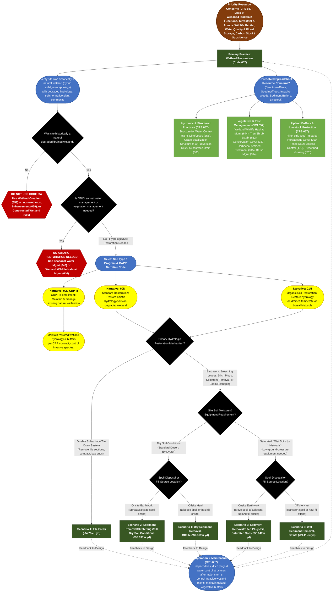

# Practice 657: Wetland Restoration
**Source Documents:** NRCS CPS 657 (Nov 2024), FY 2026 Practice Payment Scenarios, and CAPP Narrative/Resource Concern Data

[← Back to Master Index](./README.md)

---

## 1. Decision Flowchart

---

## 2. Resource Concern & Component Mapping Matrix

| Resource Concern Category (CAPP) | Resource Concern & Components (CAPP) | Direct Match to CPS 657? | Matching Narrative Code & Scenario(s) | Required Supporting Practices (from CPS 657) |
| :--- | :--- | :--- | :--- | :--- |
| **Long term protection of land** | • Loss of wetland functions and values • Loss of floodplain functions and values • Threat of conversion | **Yes (Primary Purpose)** | **00N**: Scen. 1, 2, 3, 4, 5 (Restores historic wetland hydrology, soils, and floodplain connectivity) **01N**: Scen. 3, 4, 5 (Histosol restoration) **00N-CRP-R**: CRP Maintenance | **Structure for Water Control (587)**, **Dike/Levee (356)**, **Wetland Wildlife Habitat Management (644)**; pair with wetland easements where applicable. |
| **Animals (Terrestrial habitat)** & **Animals (Aquatic habitat)** | • Terrestrial habitat for wildlife and invertebrates • Aquatic habitat for fish and other organisms • Water temperature effects on aquatic habitat | **Yes (Primary Purpose)** | **00N / 01N**: Scen. 1–5 (Re-establishes natural hydroperiods for waterfowl, amphibians, invertebrates, and floodplain fish) | **Wetland Wildlife Habitat Management (644)**, **Seasonal Water Management for Wildlife (646)**, **Tree/Shrub Establishment (612)** (for forested wetlands). |
| **Water (Weather resilience)** & **Water (Source water depletion)** | • Ponding and flooding (floodwater attenuation) • Seasonal high water table &amp; seeps • Groundwater &amp; surface water depletion, drought | **Yes (Primary Purpose)** | **00N / 01N**: Scen. 1–5 (Ditch plugs, levee breaches, and tile breaks restore natural water storage and groundwater recharge) | **Diversion (362)**, **Grade Stabilization Structure (410)** (at outlets to prevent head-cutting), **Subsurface Drain (606)** (to protect adjacent land). |
| **Soil (Soil quality limitations)** & **Air (Air quality emissions)** | • Subsidence (organic soil oxidation) • Organic matter depletion &amp; compaction • GHGs - carbon stock &amp; nitrogen fertilizer | **Yes (Primary Purpose — Histosols)** | **01N**: Scen. 3, 4, 5 (Re-wetting drained temperate/boreal histosols halts peat subsidence and restores carbon sequestration) **00N**: Scen. 1–5 (Low-ground-pressure gear prevents compaction) | **Conservation Cover (327)**, **Critical Area Planting (342)** (stabilize disturbed spoil/dikes immediately). |
| **Water (Field sediment, nutrient, pathogen, &amp; pesticide loss)** | • Sediment from erosion sources • Nonpoint N, P, pathogen, &amp; pesticide losses | **Yes (Primary / Co-Benefit)** | **00N / 01N**: Scen. 1–5 (Restored wetlands trap sediment and denitrify/filter runoff; *install upland buffers if inflow is sediment-laden*) | **Filter Strip (393)**, **Riparian Herbaceous Cover (390)**, **Sediment Basin (350)** (to prevent premature wetland sedimentation). |
| **Plants (Degraded plant condition)** | • Plant productivity and health • Plant structure and composition | **Partial (Hydrologic Foundation)** | **00N / 01N**: Restored hydroperiod enables hydrophytic native plant regeneration; supplemental planting used if seed bank is depleted | **Tree/Shrub Establishment (612)**, **Wildlife Habitat Planting (420)**, **Wetland Wildlife Habitat Management (644)**. |
| **Plants (Pest pressure)** | • Invasive species • Plant pest pressure &amp; chemical resistance | **No (Supporting / O&amp;M)** | *Disturbed wetland soils are vulnerable to reed canarygrass, cattail, or phragmites invasion during restoration*. | **Herbaceous Weed Treatment (315)**, **Brush Management (314)**, **Prescribed Burning (338)**, **Pest Management (595)**. |
| **Soil (Wind and water erosion)** & **Soil (Concentrated erosion)** | • Sheet, rill, wind, bank, and gully erosion | **No (Supporting / Outlet Protection)** | *Earthwork spoils and wetland outlets must be stabilized to prevent erosion*. | **Grade Stabilization Structure (410)**, **Critical Area Planting (342)**, **Mulching (484)**, **Streambank Protection (580)**. |
