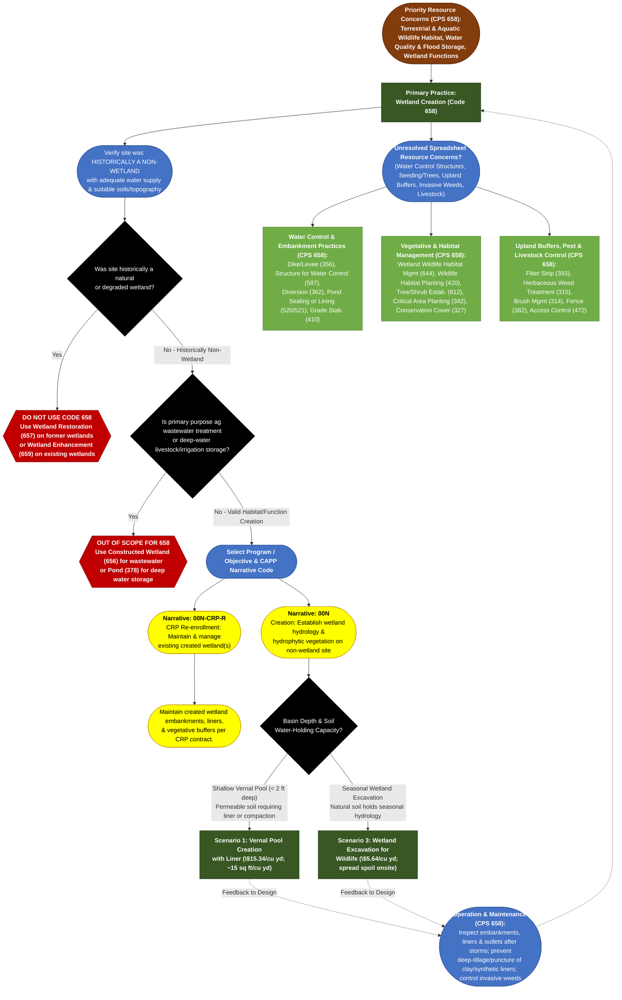

# Practice 658: Wetland Creation
**Source Documents:** NRCS CPS 658 (Jan 2026), FY 2026 Practice Payment Scenarios, and CAPP Narrative/Resource Concern Data

[← Back to Master Index](./README.md)

---

## 1. Decision Flowchart

---

## 2. Resource Concern & Component Mapping Matrix

| Resource Concern Category (CAPP) | Resource Concern & Components (CAPP) | Direct Match to CPS 658? | Matching Narrative Code & Scenario(s) | Required Supporting Practices (from CPS 658) |
| :--- | :--- | :--- | :--- | :--- |
| **Animals (Terrestrial habitat)** & **Animals (Aquatic habitat)** | • Terrestrial habitat for wildlife and invertebrates (amphibians, waterfowl, shorebirds, pollinators) • Aquatic habitat for fish and other organisms • Water temperature effects on aquatic habitat | **Yes (Primary Purpose)** | **00N**: • **Shallow Vernal Pools (&lt;2 ft)**: Scen. 1 (Vernal Pool Creation with Liner) • **Seasonal Upland Wetland**: Scen. 3 (Wetland Excavation for Wildlife) **00N-CRP-R**: CRP Maintenance | **Wetland Wildlife Habitat Management (644)**, **Seasonal Water Management for Wildlife (646)**, **Wildlife Habitat Planting (420)**, **Structures for Wildlife (649)** (logs/basking platforms). |
| **Long term protection of land** | • Loss of wetland functions and values • Loss of floodplain functions and values • Threat of conversion | **Yes (Primary Purpose)** | **00N**: Scen. 1 or 3 (Creates new wetland functions on capable non-wetland sites) **00N-CRP-R**: Maintains enrolled CRP created wetlands | **Structure for Water Control (587)**, **Dike/Levee (356)**, **Tree/Shrub Establishment (612)** (for forested wetland creation). |
| **Water (Weather resilience)** & **Water (Source water depletion)** | • Ponding and flooding (runoff detention) • Seasonal high water table &amp; seeps • Groundwater &amp; surface water depletion, drought | **Yes (Primary / Hydrology)** | **00N**: Scen. 1 or 3 (Detains surface runoff and creates seasonal water storage; *ensure water rights/supply are adequate*) | **Diversion (362)** (to route clean overland flow into basin), **Grade Stabilization Structure (410)** (at spillway/outlet). |
| **Water (Field sediment, nutrient, pathogen, &amp; pesticide loss)** | • Sediment from erosion sources • Nonpoint N, P, pathogen, &amp; pesticide losses | **Partial (Co-Benefit / Buffer Req.)** | **00N**: Scen. 1 or 3 (Created wetlands filter runoff; *must establish upland vegetated buffers if inflow carries sediment/agrichemicals*) | **Filter Strip (393)**, **Conservation Cover (327)**, **Sediment Basin (350)**; use **Constructed Wetland (656)** if treating concentrated ag wastewater. |
| **Plants (Degraded plant condition)** & **Plants (Pest pressure)** | • Plant productivity &amp; health, structure &amp; composition • Invasive species &amp; plant pest pressure | **Partial (Establishment &amp; O&amp;M)** | **00N**: Establishes native hydrophytic plant communities; *protect liners from deep-rooted woody invasives* | **Wetland Wildlife Habitat Management (644)**, **Herbaceous Weed Treatment (315)**, **Brush Management (314)**, **Prescribed Burning (338)**. |
| **Soil (Wind and water erosion)** & **Soil (Concentrated erosion)** | • Sheet, rill, wind, bank, and gully erosion | **No (Supporting / Earthwork)** | *Excavated spoils spread on adjacent uplands and constructed embankments must be stabilized immediately*. | **Critical Area Planting (342)**, **Mulching (484)**, **Grade Stabilization Structure (410)**. |
| **Animals (Livestock production limitation)** | • Inadequate livestock water, shelter, &amp; forage balance | **No (Exclusion / Protection)** | *CPS 658 is not a livestock watering pond; livestock must be excluded to protect liners, embankments, and water quality*. | **Fence (382)**, **Access Control (472)**, **Watering Facility (614)**, **Pond (378)**. |
| **Soil (Soil quality), Water (Pollutants/Salts), Air (Emissions), Energy** | • Compaction, organic matter, salts, subsidence • Confined animal/mine/agrichemical storage • GHGs, Odor, Ozone, PM, Reactive N, Energy | **No Association** | *No 658 Payment Scenario resolves these components* (present in CSV only due to system-wide RC table cross-join). | Not addressed by CPS 658. Planner must use **Constructed Wetland (656)** for ag wastewater, or dedicated waste/air/energy standards. |
