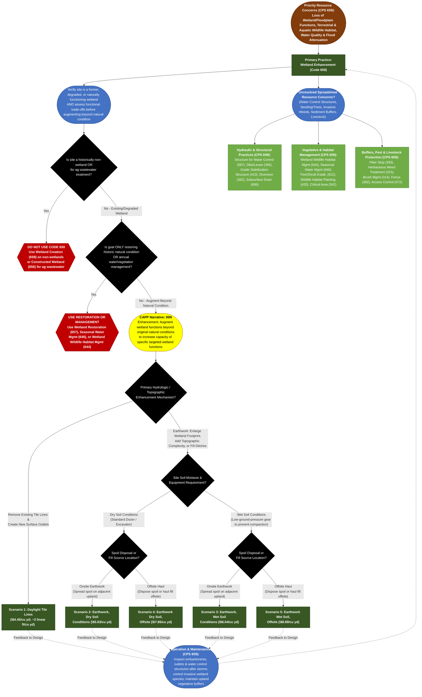

# Practice 659: Wetland Enhancement
**Source Documents:** NRCS CPS 659 (Nov 2024), FY 2026 Practice Payment Scenarios, and CAPP Narrative/Resource Concern Data

[← Back to Master Index](./README.md)

---

## 1. Decision Flowchart

---

## 2. Resource Concern & Component Mapping Matrix

| Resource Concern Category (CAPP) | Resource Concern & Components (CAPP) | Direct Match to CPS 659? | Matching Narrative Code & Scenario(s) | Required Supporting Practices (from CPS 659) |
| :--- | :--- | :--- | :--- | :--- |
| **Long term protection of land** | • Loss of wetland functions and values • Loss of floodplain functions and values • Threat of conversion | **Yes (Primary Purpose)** | **00N**: Scen. 1, 2, 3, 4, 5 (Augments specific wetland functions—flood storage, water quality, or habitat—beyond baseline) | **Structure for Water Control (587)**, **Dike/Levee (356)**, **Wetland Wildlife Habitat Management (644)**. |
| **Animals (Terrestrial habitat)** & **Animals (Aquatic habitat)** | • Terrestrial habitat for wildlife and invertebrates • Aquatic habitat for fish and other organisms • Water temperature effects on aquatic habitat | **Yes (Primary Purpose)** | **00N**: • **Expand Surface Water**: Scen. 1 (Daylight Tile Lines) • **Topographic Complexity / Micro-topography**: Scen. 2, 3, 4, 5 (creates varied water depths for waterfowl, amphibians &amp; fish) | **Wetland Wildlife Habitat Management (644)**, **Seasonal Water Management for Wildlife (646)**, **Structures for Wildlife (649)** (logs/basking structures). |
| **Water (Weather resilience)** & **Water (Source water depletion)** | • Ponding and flooding (increased flood storage) • Seasonal high water table &amp; seeps • Groundwater &amp; surface water depletion, drought | **Yes (Primary Purpose)** | **00N**: Scen. 1–5 (Increases basin detention capacity, hydroperiod duration, and groundwater recharge) | **Diversion (362)**, **Grade Stabilization Structure (410)** (outlet erosion control), **Subsurface Drain (606)** (adjacent drainage protection). |
| **Water (Field sediment, nutrient, pathogen, &amp; pesticide loss)** | • Sediment from erosion sources • Nonpoint N, P, pathogen, &amp; pesticide losses | **Yes (Primary / Co-Benefit)** | **00N**: Scen. 1–5 (Increased residence time &amp; surface area enhance nutrient denitrification and sediment retention; *install buffers if inflow is sediment-laden*) | **Filter Strip (393)**, **Riparian Herbaceous Cover (390)**, **Sediment Basin (350)**. |
| **Plants (Degraded plant condition)** & **Plants (Pest pressure)** | • Plant productivity &amp; health, structure &amp; composition • Invasive species &amp; plant pest pressure | **Partial (Topographic / O&amp;M)** | **00N**: Topographic variation (Scen. 2–5) supports diverse emergent/submergent plant zones; *control invasives stimulated by earthwork* | **Herbaceous Weed Treatment (315)**, **Brush Management (314)**, **Prescribed Burning (338)**, **Tree/Shrub Establishment (612)**. |
| **Soil (Wind and water erosion)** & **Soil (Concentrated erosion)** | • Sheet, rill, wind, bank, and gully erosion | **No (Supporting / Earthwork)** | *Spoil spread on adjacent uplands and modified outlets must be stabilized immediately*. | **Critical Area Planting (342)**, **Mulching (484)**, **Grade Stabilization Structure (410)**. |
| **Animals (Livestock production limitation)** | • Inadequate livestock water, shelter, &amp; forage balance | **No (Exclusion / Managed Grazing)** | *Livestock must be excluded during establishment or managed under prescribed grazing to protect enhanced wetland features*. | **Fence (382)**, **Access Control (472)**, **Prescribed Grazing (528)**, **Watering Facility (614)**. |
| **Soil (Soil quality), Water (Pollutants/Salts), Air (Emissions), Energy** | • Compaction, organic matter, salts, subsidence • Confined animal/mine/agrichemical storage • GHGs, Odor, Ozone, PM, Reactive N, Energy | **No Association** | *No 659 Payment Scenario resolves these components* (present in CSV only due to system-wide RC table cross-join). | Not addressed by CPS 659. Planner must use **Constructed Wetland (656)** for ag wastewater, or dedicated waste/air/energy standards. |
